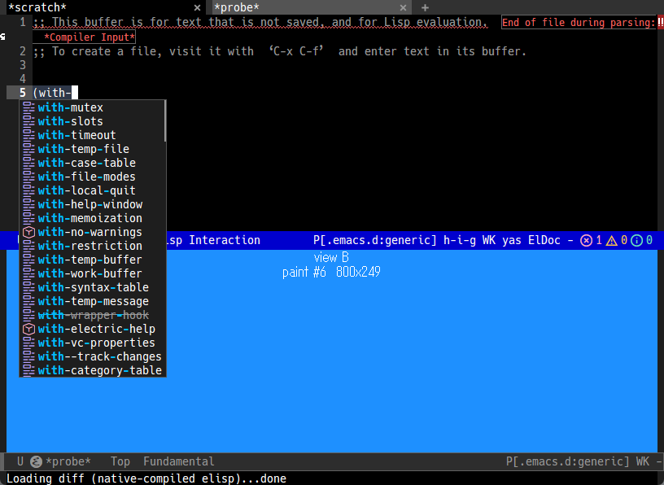

<!-- -*- gfm -*- -->

# Emacs のフレームに子 HWND を埋め込む（Windows）

**dynamic module から、Emacs のウィンドウの本文領域にネイティブの子ウィンドウを
重ねられるか**を確かめたプローブの記録。結論は**できる**。GenPreview の検索操作の
改善（短冊状の画像を貼る方式からの脱却）の前提調査として、2026-11-10 に実測した。

最終更新: 2026-11-10 ／ [README.md](../../README.md) ／ [CLAUDE.md](../../CLAUDE.md)

---

## 背景: xwidget は使えない

Emacs 31.1 の xwidget は、**WebKit のビューを埋め込む機能**でしかない。

- `configure.ac:645-646`: 対応は **GTK3 + WebKitGTK** と **macOS Cocoa + WebKit.framework**
  の 2 つだけ。w32 は構成の選択肢に無い
- `src/xwidget.c:306`: `type` が `webkit` 以外なら弾く。昔あったボタンやスライダーなどの
  型は消えており、**作れるのは Web ビューだけ**

仮に w32 に xwidget が来ても、手に入るのは WebView であって、任意のネイティブ描画を
貼る口にはならない。

## 仕組み: HWND は Lisp から取れる

```elisp
(frame-parameter nil 'window-id)   ; => "29693586" (HWND の 10 進文字列)
```

| ソース | 内容 |
|---|---|
| `src/frame.c:5457-5463` | `FRAME_NATIVE_WINDOW (f)` を `uintptr_t` にして `window-id` に入れる。コメントにも「MS-Windows では HANDLE」とある |
| `src/w32fns.c:2734-2735` | フレームには**必ず `WS_CLIPCHILDREN`** が付く（「Always clip children」）。子 HWND の上を Emacs の再描画が塗らない |
| `src/w32fns.c:2706-2707` | 子フレーム自体が `WS_CHILD` の HWND。**フレームの中に別の HWND がいる状態は Emacs が普段から扱っている** |

module が自前の UI スレッドで `CreateWindowEx (WS_CHILD, ..., parent = その HWND)` し、
`window-inside-pixel-edges` の位置に置けばよい。

**Emacs 側に埋め込みの API は無いが、要らない。** 以前 [pty/ghostel.md](../pty/ghostel.md)
と CLAUDE.md §2 に「Windows の Emacs に HWND を埋める API は無く、画像として貼る以外の
道が無い」と書いていたのは誤りだった。

---

## プローブ

ソースは [hwnd-probe/](hwnd-probe/)。C の module 1 本（`hwnd-probe.c`）と、
測定を自動で進めて `kill-emacs` する駆動スクリプト 2 本。

| | 起動 | 見たもの |
|---|---|---|
| `probe.el` | `emacs -Q -l probe.el` | 作成・座標・再描画・分割・子フレームとの順序・フォーカス・スレッドの詰まり |
| `probe2.el` | `emacs -l probe2.el`（**init.el を読む**） | DPI（150% のモニタ）・ホイールとドラッグ・tab-bar・最小化・本物の corfu |

```sh
mkdir -p tmp/hwnd-probe && cp docs/embed/hwnd-probe/* tmp/hwnd-probe/ && cd tmp/hwnd-probe
gcc -O2 -Wall -shared -o hwnd-probe.dll hwnd-probe.c \
    -I/c/Apps/emacs/emacs-31.1/include -luser32 -lgdi32
/c/Apps/emacs/emacs-31.1/bin/emacs.exe -Q -l "$PWD/probe.el"    # => out.txt
```

**docs の中ではビルドしない**（DLL と結果がそのディレクトリに出る）。

### 測り方

- **使っている Emacs には読み込まない。** module は unload できず、落ちれば
  セッションごと（Emacs 内の Claude Code も）道連れになる。別プロセスの GUI Emacs を
  起こし、`run-at-time` で 0.5 秒おきに手順を進める（コマンドループに戻して再描画と
  入力を処理させるため）
- **色は画面から読む。** module の `hwnd-probe-pixel` が `GetDC (NULL)` + `GetPixel`
  で、DWM が合成した後の実際の色を返す。フレームは測定中だけ `HWND_TOPMOST` にする
  （隠れていると測れない）
- **150% のモニタでは物理ピクセルに直して読む。** Emacs は system-aware なので、
  論理座標のまま `GetPixel` すると実際の表示とずれる。
  `LogicalToPhysicalPointForPerMonitorDPI` で直し、スレッドを一時的に
  per-monitor aware v2 にして読む
- **入力は本物（`SendInput`）。** ただし押す点の一番上が自分の子 HWND かを
  `WindowFromPoint` で確かめてから押す（よそのアプリを押さないため）。
  キーは Emacs が前面のときだけ F24 を送る
- **`probe2.el` は終了時に `kill-emacs-hook` を空にする。** init.el を読むので、
  放っておくと `recentf` / `history` を書き戻す（実行前後で md5 一致を確認した）

### 環境

Windows 11 Pro、Emacs 31.1（`dpiAware` = true = system-aware。
`nt/emacs-x64.manifest:37`）。ディスプレイは 3 枚。

| | 物理 | 倍率 | Emacs から見た矩形（論理） |
|---|---|---|---|
| ディスプレイ 1 | 1920×1080 | 125% | (1620, 1440) 1536×864 |
| ディスプレイ 2（プライマリ） | 2560×1440 | 100% | (0, 0) 2560×1440 |
| ディスプレイ 3 | 3840×2160 | 150% | (3540, 0) 2560×1440 |

---

## 結果 1: 基本（`emacs -Q`）

| 確かめたこと | 結果 |
|---|---|
| 作成 | **作れる。** module の UI スレッドで `WS_CHILD`、3.4 ms |
| 座標 | **`window-inside-pixel-edges` がそのまま親のクライアント座標。** 本文の 4 辺とも、境界の内側 1 px は view の色、外側 1 px はフリンジ・ツールバー・モードラインの色。ツールバーはクライアント領域の内側、メニューバーは外側 |
| 再描画 | 本文の書き換え・スクロール・`(redisplay t)` の後も view のまま。**view の `WM_PAINT` も増えない**（Emacs の再描画は子 HWND に波及しない） |
| 分割・リサイズ | `window-size-change-functions` / `window-buffer-change-functions` の 2 つで追従。リサイズ 1 回でフック 1 回 |
| 別のバッファを出す | フックで隠れる |
| フォーカス | **クリックしても奪わない。** `WM_MOUSEACTIVATE` に `MA_NOACTIVATE` を返し、`WS_EX_NOACTIVATE` を付ける。`WM_SETFOCUS` は 0 回 |

### 重なり順

子フレーム（corfu / posframe）も同じ親の子 HWND、つまり view の兄弟。

| 状況 | 上に出たもの |
|---|---|
| view の後に子フレームを作る | 子フレーム |
| view の前に子フレームを作り、後から view を作る | 子フレーム |
| view を `HWND_TOP` に上げる | **view（ポップアップが隠れる）** |
| その後、子フレームを隠して出し直す | **view のまま** |
| その後、子フレームを `set-frame-position` で動かす | **view のまま** |
| view を `HWND_BOTTOM` に戻す | 子フレーム |
| `SWP_NOZORDER` で view を動かす・出し直す | 子フレームのまま |

**明示的に上げなければ子フレームは上に出るが、一度上げると Emacs 側からは
取り返せない**（Emacs は子フレームを出し直しても上げ直さない）。

### スレッドが詰まったとき

UI スレッド（子 HWND を持つスレッド）を 2 秒 `Sleep` させて測った。

| 眠っている間にしたこと | 結果 |
|---|---|
| （基準。眠らせない） | Emacs が F24 を受け取るまで 3.3 ms |
| F24 を送るだけ | **3.4 ms（影響なし）**。Lisp のタイマーも 312 ms で予定どおり発火、Emacs の GUI スレッドへの `WM_NULL` も 0.3 ms |
| **view をクリックしてから** F24 | **1851 ms（UI スレッドが起きるまで止まる）** |
| Lisp から `SendMessageTimeout` で move を頼む | **Lisp スレッドが 1947 ms 待たされる** |

親と子が別スレッドだと、Windows は 2 つのスレッドの**入力キューを暗黙に連結する**。
view 宛ての入力が処理されずに溜まると、その後ろに並んだ Emacs のキー入力も
待たされる。**「重い描画の最中にユーザーが view をクリックした」が実際に起きる
パターン。**

---

## 結果 2: DPI・入力・実際の設定（init.el）

### DPI（ディスプレイ 3、150%）

| | ディスプレイ 2（100%） | ディスプレイ 3（150%） |
|---|---|---|
| Emacs から見た DPI・クライアント領域 | 96、816×596 | **96、816×596**（変わらない） |
| 画面上の実寸 | 816×596 | **1224×894** |
| 本文の境界から 2 px 内側／外側 | 正しい | **正しい** |
| 境界ちょうどの 1 px | 正しい | 中間色（引き伸ばしの補間） |

- **DWM が Emacs のフレームを子 HWND ごと 1.5 倍に引き伸ばす。** Emacs から見た
  座標は変わらないので、**モニタを移っても追従処理は要らない**
- その代わり、**view は 96 dpi で描いたものが引き伸ばされ、Emacs の文字と同じく
  ぼやける。** Direct2D で描いても 150% のモニタでは鮮明にならない。
  直すには Emacs 自身がモニタごとの DPI に対応する必要がある（module からは
  手が出せない見込み。未検証）
- **system-aware のスレッドから `GetDpiForMonitor` を呼ぶと仮想化された値（96）が
  返る。** 倍率は「物理サイズ ÷ 論理サイズ」で見る（最初これで 150% のモニタを
  見つけ損ねた）

### ホイールとドラッグ

ディスプレイ 2 → 3 → 2 の 3 回とも同じ結果。

| | 結果 |
|---|---|
| ホイール 3 ノッチ | **view に 3 通（delta -360）、Emacs には 0 件。** 本文もスクロールしない |
| view の外までドラッグ | `SetCapture` が効き、10 回の移動を全部受け取る（うち 3 回は view の外） |
| フォーカス | ドラッグの後も Emacs のフレーム |

ホイールが view に届くのは `HKCU\Control Panel\Desktop\MouseWheelRouting` = 2
（ホバー中の非アクティブなウィンドウもスクロールする。Windows の既定）だから。
**切ってある環境では Emacs のフレームに届く。**

### 実際の設定との組み合わせ

| | 結果 |
|---|---|
| tab-bar・doom-modeline | `window-inside-pixel-edges` がタブバー（18 px）込みの位置を返し、正しく合う |
| 新しいタブを開く | 元のウィンドウは `window-live-p` が nil になり、フックで view が隠れる |
| 元のタブに戻る | **同じウィンドウオブジェクトが生き返り**（`eq` で一致）、フックで同じ位置に再表示 |
| 最小化 → 復帰 | 親と一緒に隠れて戻る。Lisp 側の処理は不要 |
| **本物の corfu** | **ポップアップが view の上に出る** |



---

## 設計上の約束

これを使うもの（まず GenPreview）を書くときに守ること。番号は上の結果との対応。

1. **子 HWND を持つスレッドで重い処理をしない。** メッセージを捌くだけにして、
   ラスタライズなどは別スレッドへ。入力キューが連結されるので、詰まると Emacs の
   キー入力まで止まる
2. **Lisp からの操作は非同期（`PostMessage`）で送る。** 同期で待つ口が要るなら
   タイムアウトを短く。`SendMessageTimeout` は待っている間 Lisp スレッドを止める
3. **view は作った時点で `HWND_BOTTOM` に置き、二度と上げない。** 動かすときは
   `SWP_NOZORDER`。上げると子フレームが隠れ、Emacs 側からは取り返せない
4. **位置合わせは `window-size-change-functions` と
   `window-buffer-change-functions` で足りる。** タブの切り替え・分割・リサイズ・
   バッファの切り替えをすべて拾った。最小化とモニタ移動は何もしなくてよい
5. **ホイールは view が直接受けるが、Emacs 側に来たときの転送経路も用意する**
   （`MouseWheelRouting` 次第でどちらにも来る）
6. **view をクリックしても Emacs のウィンドウは選ばれない。** 分割しているなら
   「クリックした view のウィンドウに移る」を自分で作る。module の別スレッドから
   Lisp は呼べないので、知らせる経路は **`open_channel`**（module API。パイプの
   プロセスに書き、プロセスフィルタで受ける）が筋
7. **キー操作は Emacs のキーマップで受けて module に渡す。** フォーカスは Emacs に
   残るので、検索ならミニバッファで 1 文字ごとに module にハイライトさせる形になる
8. **150% のモニタではぼやける**のは、今の Emacs では避けられない

## 確かめていないこと

- **IME。** フォーカスが Emacs に残るので影響は無い見込みだが、tr-ime を有効に
  したまま view を操作したことはない
- **プロセスをまたぐ埋め込み**（別プロセスの HWND を `SetParent` する）。
  これでも入力キューは連結されるはずで、約束 1 は同じく要る
- **Emacs 自身の GUI スレッドとのデッドロック。** UI スレッドから Emacs の
  フレームへ同期メッセージを送る経路は作っていない（`WS_EX_NOPARENTNOTIFY` で
  `WM_PARENTNOTIFY` も止めてある）。作るならタイムアウト付きで
- **端末への応用。** 埋め込みの道はこれで開いたが、描画の自作という障壁は残る
  （[pty/ghostel.md](../pty/ghostel.md)）
