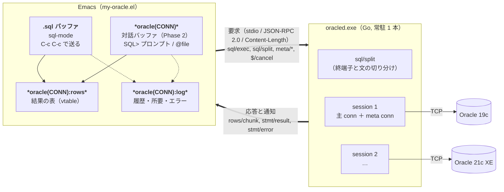

<!-- -*- gfm -*- -->

# Emacs 専用 Oracle クライアント（`oracled`）アーキテクチャ検討

2026-10-28。**実装するかどうかは未定**。SQLcl を `sql.el` から使う現状
（`docs/languages/sqlcl.md`）の代わりに、**Windows 専用・Emacs からしか使わない**
前提で軽量クライアントを作るとしたらどうなるかの検討。

| | |
|---|---|
| 想定の形 | Go のシングルバイナリ（`oracled.exe`）+ Elisp（`my-oracle.el`） |
| 置き場所 | ソースは `oracled/`、バイナリは `oracled/oracled.exe`（**git 管理外**。`ptyd/` と同じ扱い） |
| 命名 | 関数・変数は `my:oracle-` 接頭辞。`gitd` / `ptyd` と同じ流儀で、**ディレクトリ名 = 実行ファイル名** |
| 通信 | stdio 上の JSON-RPC 2.0（`gitd` と同じ流儀） |
| 想定環境 | Windows 11 / Emacs 31.1 / Oracle 21c XE（手元）、業務の 19c |
| **この文書の数字** | SQLcl 側は実測（`docs/languages/sqlcl.md`）。**新規側は全部見積もりで未実測** |

---

## 1. 目的と非目標

### 目的

「SQL を書いて投げ、結果を読み、ときどき DDL を調べる」という**日常の 95%** を、
SQLcl の中途半端さに付き合わずに済ませる。具体的には次の 5 つを設計で消す。

1. **起動 8 秒**（JVM + 接続）
2. **テキストを往復で読み合うこと**（プロンプト同期・列幅・ANSI escape・右埋め）
3. **文字コードの食い違い**（stdin だけ cp932、`JDK_JAVA_OPTIONS` の NOTE 行）
4. **割り込めないこと**（走っている SELECT を止める手段が無い）
5. **SQL\*Plus 互換の残骸**（裸の `/` が直前の文を再実行する、`SHOW` が 1 語しか
   取らない、`SET COLOR OFF` が効かない、継続プロンプトを出さない）

### 非目標（SQLcl を消さない）

**`my:sql-sqlcl` は残す。** SQLcl にしか無いものを置き換える気は無い。

| SQLcl に任せる | |
|---|---|
| `ddl` / `datapump` / `liquibase` / `aid` | 実装する気のない機能 |
| **フルスペックの SQL\*Plus 互換スクリプト** | `SET` / `COLUMN` / `SPOOL` / `DEFINE` / `&1` / `WHENEVER SQLERROR` を使う既存の `.sql` 資産 |
| `INFO+` 相当の全部 | 統計・索引・ヒストグラムまで見たいとき |

新しい側は **「対話で SQL を投げる」ことに特化**する。SQL\*Plus のコマンド言語は
**原則として解釈しない**（§7）。例外は `@` / `@@` と数個だけで、それも
**Emacs 側のクライアントコマンド**として実装する（§12「`@filename`」）。
**対応していない SQL\*Plus コマンドは Oracle に送らず、無視したことを必ず報告する。**

---

## 2. 構成



| バッファ | |
|---|---|
| `*oracle(CONN)*` | **対話バッファ**（Phase 2）。`SQL> ` プロンプトで入力 → 応答 |
| `*oracle(CONN):rows*` | 結果の表。**最新の 1 件だけ**を持つビュー |
| `*oracle(CONN):log*` | 発行した文・件数・所要・エラーの履歴（テキスト） |

**【重要】「これは自分のバッファか」をバッファ名で判定しない。**
接続名が入るので、`my-claude` と同じくメジャーモードで見る
（`my:oracle--repl-p` / `my:oracle--rows-p`）。

- **daemon は 1 本**（Emacs 1 プロセスに 1 本。`gitd` と同じ）。接続は
  その中の **session** として複数持つ
- Emacs 側は **同期待ちをしない**（`jsonrpc-async-request`）。これが割り込みと
  逐次表示の前提になる
- **バイナリが無ければ機能が無効になるだけ**（`gitd` / `ptyd` と同じ約束）

---

## 3. 言語とドライバ

ここが**この検討でいちばん重い意思決定**。「シングルバイナリ」を本気で取るなら
選択肢は実質 1 つになる。

| | 言語 | Instant Client | 単一 .exe | 成熟度 |
|---|---|---|---|---|
| **sijms/go-ora v2** | Go | **不要**（純 Go で TNS を実装） | **○** | 実績多数・個人開発 |
| oracle/go-oracledb | Go | 不要（純 Go、Oracle 公式） | ○ | **v26.0.0-beta**。機能が狭い |
| godror | Go | **必要**（cgo + ODPI-C） | × | 高い（OCI そのまま） |
| rust-oracle (`oracle` crate) | Rust | **必要**（ODPI-C） | × | 高い |
| 純 Rust 実装 | — | — | — | **存在しない** |

### 決め（検討上の前提）

**Go + sijms/go-ora v2 を第一候補にする。**

- **Instant Client が要らない**ことの価値が大きい。`gitd` / `ptyd` と同じ
  「`M-x my:oracle-build` で作って終わり」になる。OCI 系は DLL の配布・PATH・
  32/64bit・バージョン差が全部こちらに降りてくる
- Go なのは `ptyd` の前例があるから（`golang.org/x/sys` の扱いを含め既知）。
  Rust を選ぶ理由は ODPI-C を使う場合しか無く、それなら Go + godror と同じ条件
- **公式の pure Go（go-oracledb）は beta で、機能が明確に狭い**（ユーザー名 /
  パスワード認証のみ、REF CURSOR や接続プールが未記載、`NUMBER` が基本 string）。
  ただし**将来の移行先の第一候補**なので、ドライバはインターフェースの裏に
  置いて差し替え可能にしておく

### ドライバ層を薄くする

```go
type Driver interface {
    Connect(ctx context.Context, dsn DSN) (Conn, error)
    // Query/Exec/Describe は database/sql の上に薄く乗せる
}
```

go-ora は `database/sql` 準拠なので、**`database/sql` の語彙だけで書けば
go-oracledb / godror への差し替えは DSN 組み立てとエラー解析だけになる**。
driver 固有の API（`go_ora.NewConnector`、UDT 登録、Direct Path）は使わない。

### 【重要】`database/sql` のプールを使ってはいけない

`sql.DB` は接続プールなので、**文ごとに別のセッションに飛びうる**。
トランザクション・`ALTER SESSION`・GTT・`DBMS_OUTPUT` が全部壊れる。

```go
db.SetMaxOpenConns(1)              // ではなく
conn, err := db.Conn(ctx)          // 固定した 1 本を session に握らせる
```

session は **`*sql.Conn` を 1 本握り続ける**（主 conn）。必要なら**メタ用に
もう 1 本**（§10）。

---

## 4. プロトコル

### フレーミング

| 候補 | 利点 | 欠点 |
|---|---|---|
| **JSON-RPC 2.0 + `Content-Length`** | 同梱 `jsonrpc.el` が id / コールバック / 通知を全部持つ。`gitd` と同じ | 行指向でないのでログを目で追いにくい |
| JSON Lines 手書き | `ptyd` / `my-claude` と同じ。streaming が素直 | id 管理・エラー・キャンセルを自分で書く（`my-claude` が 5000 行になった一因） |
| S 式（`read`） | **テキストプロパティ付き文字列をそのまま書ける**（`#("a" 0 1 (face x))`） | Go 側に sexp writer を自作。Emacs 以外から叩けない |

**JSON-RPC 2.0 + `Content-Length` を採る。** 理由は 2 つ。

- 割り込み（`$/cancel`）と逐次表示（サーバ発の通知）の両方が要るので、
  **id とコールバックの管理が必須**。`jsonrpc.el` にそれがある
- **daemon を Emacs 以外から叩けること**（CLI モード、Go のテスト）を検証の
  前提にしたい（§16）。sexp にするとそれが死ぬ

S 式案の「face 付きで渡せる」利点は、**装飾は Emacs 側でやるべき**（§12）なので
捨てて困らない。JSON のパースは `json-parse-buffer`（C 実装）で、
`:object-type 'plist` にすると `jsonrpc.el` の流儀に揃う。

### メソッド

| メソッド | 向き | |
|---|---|---|
| `initialize` | → | `{protocol, version, pid, driver}` を返す。**`my:oracle-protocol` と不一致なら Emacs 側が機能を無効化**（`gitd` と同じ） |
| `conn/list` | → | 接続定義の一覧（daemon は定義を持たない。後述のとおり Emacs から渡す） |
| `session/open` | → | `{dsn, autocommit, nls}` → `{session, user, db, instance, sid, serial, version}` |
| `session/close` | → | **明示 ROLLBACK してから** logoff（§6 の【重要】） |
| `session/info` | → | 接続状態・tx 状態・autocommit・直近の文 |
| `sql/split` | → | テキスト → 文の配列（`{text, kind, begin, end, complete}`）。`kind` は `sql` / `plsql` / **`client`**（`@file` など SQL でない行）。`complete` は**文として閉じているか**（対話バッファの `RET` 判定に使う。§12）。**Emacs 側に重複実装しない**ための窓口 |
| `sql/exec` | → | 1 文を実行。結果は通知で流す。戻り値は `{query}` |
| `rows/more` | → | 開いているカーソルから続きを取る |
| `rows/close` | → | カーソルを閉じる |
| `tx/commit` `tx/rollback` `tx/autocommit` | → | |
| `meta/objects` | → | オブジェクト一覧（構造化） |
| `meta/describe` | → | 列・制約・索引・コメント（構造化） |
| `meta/token` | → | `MAX(last_ddl_time)` 由来のキャッシュ鍵（§10） |
| `$/cancel` | → | **通知**。走っている文を break する |
| `shutdown` | → | 応答してから終了 |
| `rows/chunk` | ← | **通知**。`{query, seq, rows, done}` |
| `stmt/progress` | ← | **通知**。`{query, state, elapsed_ms}`（点を回す材料） |
| `stmt/result` | ← | **通知**。`{query, affected, elapsed_ms, warnings, dbms_output}` |
| `stmt/error` | ← | **通知**。`{query, code, message, offset, line, col}` |

`stmt/*` を**応答ではなく通知**にしているのは、1 つの `sql/exec` から
「進行 → 行の束 ×n → 結果」と複数回届くため。JSON-RPC の応答は 1 回しか返せない。

### 割り込み（`$/cancel`）が成立する条件

**Emacs 側が同期待ちをしないこと**が必須。`jsonrpc-request`（同期）で待つと、
その間 Emacs は `accept-process-output` の中にいるので `$/cancel` を**送れない**。

```elisp
(jsonrpc-async-request conn 'sql/exec params :success-fn ... :error-fn ...)
```

`C-g` / `C-c C-k` で `$/cancel` を通知 → daemon が `context` を cancel →
go-ora が break を送る（§9）。

---

## 5. 型マッピング（結果の表現）

**daemon は「表示」を作らない。値を型付きで渡し、整形は Emacs がやる。**
これが SQLcl 版との最大の違いで、列幅・ANSI・右埋め・CJK 幅の問題が全部消える。

| Oracle | JSON | 注 |
|---|---|---|
| `NUMBER`（すべて） | **string** | **go-ora は NUMBER を必ず文字列で返す**（`parameter.go:553`。精度は落ちない）。小さい整数を JSON の number に直すかは Emacs 側の都合で決める。**`ColumnTypeScanType` は `float64` / `int64` と言ってくるが嘘**（→ [phase0-findings.md](phase0-findings.md) B） |
| `VARCHAR2` / `NVARCHAR2` / `CHAR` | string | |
| `DATE` / `TIMESTAMP` | string | **オフセットを付けない ISO-8601**（`2026-10-28T12:34:56`）。NLS に依存させない。**【重要】go-ora は壁時計の時刻に `Z` の札を付けて返す**ので、地方時に変換すると 9 時間ずれる（→ [phase0-findings.md](phase0-findings.md) G） |
| `TIMESTAMP WITH TZ` | string | オフセット付き ISO-8601（こちらは正しく `+09:00` で来る） |
| `INTERVAL` | string | |
| `RAW` / `BLOB` | `{"$b64": "...", "len": N}` | 既定は先頭 N バイトだけ |
| `CLOB` / `NCLOB` | string または `{"$trunc": true, "len": N}` | **既定は先頭 4 KB**。全部欲しいときは `lob/fetch`。**【重要】go-ora は既定（`LOB FETCH=INLINE`）で中身を丸ごと転送する**（型名も `LongVarChar` になり `LONG` と区別できない）。切るには `DBMS_LOB.SUBSTR` に書き換えるか stream に切り替える（→ [phase0-findings.md](phase0-findings.md) H） |
| `BFILE` | `{"$bfile": "DIR/NAME"}` | 中身は取らない |
| `ROWID` | string | |
| `JSON`（21c+） | そのまま JSON | |
| `BOOLEAN`（23ai / PL/SQL） | bool | |
| UDT / `XMLTYPE` | string（`getStringVal()` 相当） | **初期は非対応でよい**。ドライバ差が大きい |
| NULL | `null` | **空文字と区別できる**（SQLcl のテキスト出力では区別できない） |

列メタデータも返す。

```jsonc
{ "query": 17,
  "columns": [ {"name":"ID","type":"NUMBER","scale":0,"nullable":false,"display":8},
               {"name":"NAME","type":"VARCHAR2","size":200,"nullable":true} ],
  "rows": [[1,"あいうえお"], [2,null]],
  "seq": 0, "done": false }
```

### 行の流し方

| | |
|---|---|
| 1 チャンク | **200 行**（体感の初回表示を優先） |
| 既定の上限 | **1000 行**でカーソルを開いたまま止める。`rows/more` で続き |
| カーソルの寿命 | 同じ session で次の文を投げたら閉じる。`rows/close` でも閉じる |
| 【重要】 | **開いたカーソルは主 conn を占有する**。「止めたまま放置」が autocommit off と組むと厄介なので、**`rows/more` の待ちには時間上限を置いて自動で閉じる**（既定 5 分） |

---

## 6. セッションモデル

### 【重要】閉じる前に必ず明示 ROLLBACK（実測では救われたが、依存しない）

未コミットのトランザクションを持ったまま切断したときの挙動は**条件で変わる**。

| | |
|---|---|
| **手元の実測**（21c / go-ora 2.9.0 / `DB.Close()`） | **ロールバックされた**（増えなかった） |
| go-ora issue #767 の報告 | **コミットされた**（キャンセル直後の Rollback が race で中断された経路） |
| Oracle 一般の作法 | 正常 logoff はコミット、異常切断はロールバック |

**「たまたま安全だった」に依存しない。** autocommit OFF は `*sql.Tx` 実装に
なるので（下記）、閉じる前に `tx.Rollback()` を呼ぶのは 1 行で済む。

したがって:

- `session/close` は**必ず明示 `ROLLBACK` を先に出す**
- Emacs の終了・daemon の `shutdown`・stdin EOF の**全経路**で通す
  （`os.Exit` に直行する道を作らない）
- Emacs 側は未コミットがあれば `kill-emacs-query-functions` で確認する

これは「エラーが出ず、静かにデータが変わる」類なので、**設計の最初に置く**。

### autocommit

| | |
|---|---|
| 既定 | **OFF**（`my:oracle-autocommit` = nil）。業務 DB を触るので明示コミット側に倒す |
| 切り替え | `tx/autocommit`。**トランザクション中は拒否する**（暗黙コミットを起こさない） |
| 表示 | header-line に `AC:off` / `TX` を出す。**色で分ける** |

#### 【重要】go-ora の `autoCommit` は既定 true。OFF は tx で作る

`conn.autoCommit` の初期値は `true` で、`Begin` で false、`Commit` /
`Rollback` で true に戻る（ソース確認済み。→
[phase0-findings.md](phase0-findings.md) A）。**トランザクションの外の DML は
即コミットされる**ので、「autocommit OFF」は次の形でしか作れない。

| | |
|---|---|
| autocommit ON | `*sql.Tx` を張らない |
| **autocommit OFF** | **常に `conn.BeginTx` の中。`Commit` / `Rollback` のあと即座に次の tx を張る** |

daemon 側に「いま tx を持っているか」の状態が増えるので、`session/info` の
tx 表示はこの内部状態と `DBMS_TRANSACTION.LOCAL_TRANSACTION_ID` の
両方で確かめる（下記）。

#### 【重要】tx とカーソルは「セッション寿命の context」で作る（2026-10-28）

Phase 1 の統合テストで 3 件まとめて落ちた。**原因は 1 つで、tx と
開いたままのカーソルを「文の context」で作っていたこと。**

| 症状 | |
|---|---|
| `rows/more` が `context canceled` | `Exec` から戻るときの `cancel()` でカーソルの context が死ぬ |
| 割り込み後に `sql: transaction has already been committed or rolled back` | 文を cancel すると `database/sql` が tx を道連れにロールバックする |
| そのあとの `tx/rollback` が `ORA-01013` | 同じ。tx が既に死んでいる |

`conn.BeginTx(ctx, …)` の `ctx` が死ぬと、`database/sql` は
**awaitDone で勝手に tx をロールバックして閉じる**。したがって:

- tx は `session.baseCtx`（セッション寿命）で張る
- 文は `baseCtx` の**子**で作る。cancel しても tx に波及しない
- 行を残すとき（`more` が真）は、**その文の `cancel` をカーソルに持たせて
  手放す**。`rows/close` か次の文のときに呼ぶ

**割り込みが「効く」ことと「tx が生き残る」ことは別に確かめる。**
前者だけ見ていると、ユーザーは「止めたらトランザクションが消えた」に出会う。

#### 【重要】DDL は保留中の DML を巻き込んでコミットする（実測）

tx の中で `CREATE TABLE` を実行したら、**その前の未コミットの INSERT が
確定した**（戻せなかった）。Oracle の仕様だが、**autocommit OFF のつもりで
操作しているユーザーには見えない**。

**`stmt/result` に「この文が暗黙コミットした」印を付け、Emacs 側で必ず出す。**
黙っていると「ロールバックできるつもりだったのに確定していた」になる。
→ [phase0-findings.md](phase0-findings.md) I

### トランザクション状態の判定

| 方法 | |
|---|---|
| daemon 側で DML を数える | 速いが **PL/SQL の中のコミットを見落とす** |
| `DBMS_TRANSACTION.LOCAL_TRANSACTION_ID(FALSE)` | 非 null なら tx 中。ローカル呼び出しで安い |

**併用。** 平常は数えるだけ、`stmt/result` を返す前に PL/SQL ブロック・
無名ブロック・`COMMIT` を含む文を実行した場合だけ問い合わせて直す。

### 1 session = 2 接続

| | 用途 |
|---|---|
| 主 conn | ユーザーの文・トランザクション・`DBMS_OUTPUT` |
| meta conn（遅延で張る） | オブジェクト一覧・describe・補完・**キャンセル補助**（§9） |

**理由。** 主 conn が長い SELECT で塞がっている間も補完と describe を出したい。
Oracle では DDL が暗黙コミットされるので、**別接続から見てもほぼ食い違わない**
（未コミットの DDL という状態が存在しない）。

ただし **DB 側のセッション数が 2 倍になる**。XE や接続数の厳しい環境があるので
`my:oracle-meta-connection` で切れるようにし、**切ったときは主 conn を使い回して
直列化する**（補完が待たされるだけ）。

---

## 7. SQL の切り分けと終端子

**daemon は SQL\*Plus のコマンドを実行しない。** `SET` / `SHOW` / `COLUMN` /
`SPOOL` / `DEFINE` は daemon の関知するところではなく、Emacs 側の
**クライアントコマンド**になる（`sql.el` の慣習より `psql` の `\d` に近い）。

| ユーザーの操作 | 行き先 |
|---|---|
| `SELECT` / DML / DDL / PL/SQL ブロック | `sql/exec` |
| `DESC foo` 相当（`C-c C-l t`） | `meta/describe` → Emacs が整形 |
| 一覧（`C-c C-l a`） | `meta/objects` |
| `@file` / `@@file` | **Emacs 側のスクリプト実行**（§12）。daemon には 1 文ずつ渡る |
| `SET LINESIZE` / `COLUMN` など | **無い**（表示は Emacs が決める）。**無視したことを報告する** |
| `SET SERVEROUTPUT ON` | `my:oracle-serveroutput` に読み替える（§13） |
| `&var` | **Emacs 側で置換**（`sql-placeholders-filter` を流用） |
| `:var` | **本物のバインド変数**として `sql/exec` の `binds` に渡す |

### 【重要】「実行しない」と「見分けない」は別

daemon は SQL\*Plus コマンドを**実行しない**が、**それが SQL でないことを
見分ける責任は持つ**。文の切り分けに必要だからで、たとえば `@foo.sql` は
**`;` ではなく行末で終わる**。ここを Emacs 側にも書くと lexer が 2 つになり、
必ず食い違う（SQLcl 版で `;` と `/` の扱いが散らばったのと同じ失敗）。

そのため `sql/split` は `kind: "client"` の要素を返し、**中身の解釈だけを
Emacs に任せる**。daemon が知っているのは「この行は SQL ではない」までで、
`@` が何をするかは知らない。

### 終端子の規則（daemon 側 lexer、`sql/split`）

OCI / ドライバは**末尾の `;` を受け付けない**（`ORA-00911`）。一方 PL/SQL
ブロックは中の `;` が必須。つまり**誰かが必ず判定する**ので、Go 側に 1 箇所置く。

| 入力 | daemon が投げるもの |
|---|---|
| `select 1 from dual;` | `select 1 from dual`（末尾 `;` を落とす） |
| `begin null; end;`<br>`/` | `begin null; end;`（末尾の `/` 行を落とす） |
| `create or replace procedure p is begin null; end;`<br>`/` | 同上。**中の `;` では切らない** |
| 裸の `/` | **何もしない**（SQLcl のような「直前の文を再実行」は実装しない） |
| 裸の `;` | 何もしない |
| `@scripts/foo.sql` | **投げない。**`kind: "client"` として返す（行末で終わる） |
| `select 1 from dual`（終端子なし） | `complete: false`。**対話バッファでは送らず改行する**（§12） |

lexer が分かっていなければならないもの: 行コメント `--`、ブロックコメント
`/* */`、文字列リテラル、`q'[...]'` 系の代替引用、識別子の `"..."`、
**`/` 単独行**（PL/SQL の終端）、`DECLARE` / `BEGIN` / `CREATE ... AS` で始まる
ブロックの検出、**行頭の `@` / `@@`**。**ここは Go の table-driven テストで
固める**（SQLcl 版でいちばん嫌だった部分を、テストできる場所に移すのが狙い）。

`complete` を返すのも lexer の仕事。「文字列リテラルの途中」「`BEGIN` に対応する
`END;` がまだ無い」「`;` も `/` も来ていない」を区別できるのはここだけなので、
**対話バッファの `RET` の判定を Emacs 側で正規表現で書かない。**

`sql/split` を RPC で公開しておくと、Emacs 側の「段落を送る」「リージョンを
送る」「文の範囲をハイライトする」が**同じ規則**になる（往復は 1 ms 未満の
想定なので同期で呼んでよい）。

---

## 8. エラー

SQLcl はエラーもテキストで返すので、Emacs 側からは「どこで」が分からない。
構造化すると**ソースバッファの該当位置に飛べる**。

```jsonc
{ "query": 17, "code": 904, "message": "ORA-00904: \"FOO\": 識別子が無効です。",
  "offset": 7,            // 文の先頭からの文字オフセット（OCI の parse error offset）
  "line": 1, "col": 8 }
```

- Emacs 側は `sql/exec` に渡した文の**バッファ上の開始位置**を覚えておき、
  `offset` を足して `goto-char` する。flymake に載せる手もある
- **`offset` が取れるのは構文エラーのときだけ**（実行時エラーには無い）
- **【重要】go-ora は位置を構造で渡してくれない。** `network.OracleError` は
  `ErrCode` / `ErrMsg` が公開だが、**`errPos` は非公開**で `Error()` の文字列
  （`… error occur at position: N`）にしか出ない（→
  [phase0-findings.md](phase0-findings.md) C）。文字列から剥がすか、
  §9 段 0 の fork で公開するか、初版では**文の先頭に飛ばすだけ**にする

---

## 9. 割り込み（ここが成否を分ける）

### go-ora の実装（ソース確認済み）

`v2/network/session.go`:

| | |
|---|---|
| `StartContext(ctx)` | `ctx.Done()` を見る goroutine を回し、発火したら `BreakConnection()` |
| `BreakConnection()` | **ネゴシエート済みなら OOB（`NegotiatedOptions & 0x400`）で break バイトを送る**。駄目なら **in-band の interrupt marker パケット**を書く |
| `read()` | break 後に marker が来たら `processMarker()` → `ErrConnReset` |

### 【重要】段 0（OOB の fork）は **要らない**（2026-10-28 実測）

下の「Windows では OOB が空実装」は**ソースのとおり正しい**が、
**結論は外れた**。in-band break だけで実際に止まる。
→ 実測: [phase0-findings.md](phase0-findings.md) E'

| 負荷 | 基準 | 割り込み要求から戻るまで | セッション |
|---|---|---|---|
| CPU（表の直積） | 4821.6 ms | **165.8 ms** | 生存 |
| CPU（PL/SQL ループ） | 15319.1 ms | **181.5 ms** | 生存 |
| 待ち（`DBMS_SESSION.SLEEP`） | 30125.4 ms | 1671.4 ms | 生存 |

いずれも `ORA-01013: user requested cancel of current operation` が返り、
**同じ sid で次の文が通った**。`context.WithTimeout` でも同じ
（issue #702 は再現しなかった）。

**したがって段 0 は実装しない。** fork する動機は `errPos` の公開だけ残るが、
それも `Error()` の文字列から 0 始まりで取れている（§8）。

### Windows では OOB が空実装（ソース上の事実）

`network/net_windows.go` の `sendOOB` は**中身が全部コメントアウトされていて、
必ず `(false, nil)` を返す**。非 Windows（`net_others.go`）には
`syscall.Sendmsg(..., MSG_OOB)` の実装がある。さらに `0x400`（urgent data）を
名乗るのは **DSN に `ENABLE_OOB` を書いたときだけ**（`session_ctx.go:56`）。

**つまり Windows では、何をしても in-band marker の経路にしか行かない。**

そして **in-band の break は、長い問い合わせには効きにくい**。クライアントが
応答を待っている間、**サーバは返すものができるまでソケットを読まない**ので、
marker は「次に読むまで」届かない。OOB は OS が割り込みとして届けるので即効く。
→ [SQL\*Net FAQ](https://www.orafaq.com/wiki/SQL*Net_FAQ) /
[disable_oob](http://www.dba-oracle.com/phys_disable_oob.htm)

**issue #702（`ExecContext` でタイムアウトが効かない）の症状と一致する。**

したがって段構えに **段 0** を足す（詳細と実装方針は
[phase0-findings.md](phase0-findings.md) E）。

| 段 | 手段 | |
|---|---|---|
| **0** | **`sendOOB` を Windows 向けに自分で書いて fork を `replace` で差す** | `SyscallConn()` → `WSASend(..., MSG_OOB)`。`errPos`（§8）も同時に取れるようになる |
| 1 | `context` cancel（in-band marker） | **Windows では期待できない。Phase 0 で測る** |

### 【重要】既知の問題が 2 つある

| issue | 内容 | 影響 |
|---|---|---|
| [#702](https://github.com/sijms/go-ora/issues/702) | `ExecContext` で `WithTimeout` が尊重されず走り続けた（約 1 年前） | **キャンセルが効かない条件がありうる** |
| [#767](https://github.com/sijms/go-ora/issues/767) | キャンセル後の `Rollback` が break フラグの data race で中断され、**logoff 時にコミットされた**（約 2 週間前、v2.9.0） | **データが静かに変わる** |

**どちらも「黙って間違ったことが起きる」系**なので、割り込みは**3 段構え**に
しておく。

| 段 | 手段 | 確実さ | 副作用 |
|---|---|---|---|
| ~~0~~ | ~~自前の OOB（fork）~~ | **不要**（実測。上記） | — |
| **1** | `context` cancel（in-band marker） | **実測で 165〜181 ms。これで足りる** | 無い |
| 2 | **meta conn から `ALTER SYSTEM CANCEL SQL 'sid,serial'`** | 効く（18c+。12.2 でも動く報告あり）。**可否は `session_privs` で見る**（`user_sys_privs` は直接付与だけなので 0 に見える） | `ALTER SYSTEM` 権限が要る |
| 3 | **主 conn の socket を閉じて張り直す** | 必ず止まる | **未コミットの tx が消える**（= ロールバック。logoff コミットを避けるため、閉じる前に `ROLLBACK` を出す経路は使えないので、**接続破棄＝ロールバック**として扱う） |

Emacs 側の UX: `C-c C-k` 1 回目で段 1、応答が無ければ数秒後に「強制切断して
やり直しますか」と訊いて段 3。**段 2 は権限が確認できた環境だけ**
（`my:oracle-cancel-via-alter-system`）。

**キャンセル後は必ず `session/info` で tx 状態を取り直す**（#767 を踏んでも
気づけるように）。

---

## 10. オブジェクト一覧と describe

### 構造化して返す

`DESCRIBE` のテキストを読む必要が無くなるので、**`ALL_TAB_COLUMNS` 等を
自分で引く**。SQLcl の `INFO+` が出すもののうち、実用で見るのは次。

```jsonc
{ "owner": "APP", "name": "MT_BRAND", "type": "TABLE",
  "comment": "ブランドマスタ",
  "columns": [ {"name":"ID","type":"NUMBER(10)","nullable":false,"default":null,
                "comment":"ID","pk":1} ],
  "constraints": [ {"name":"PK_MT_BRAND","type":"P","columns":["ID"]},
                   {"name":"FK_...","type":"R","columns":["BRAND_ID"],
                    "refers":"APP.MT_BRAND(ID)"} ],
  "indexes": [ {"name":"IX_...","unique":false,"columns":["NAME"]} ],
  "stats": {"num_rows": 1234, "last_analyzed": "2026-10-01T03:00:00"} }
```

引く対象（権限で `USER_*` / `ALL_*` を切り替える）:
`*_TAB_COLUMNS` / `*_COL_COMMENTS` / `*_TAB_COMMENTS` / `*_CONSTRAINTS` +
`*_CONS_COLUMNS` / `*_INDEXES` + `*_IND_COLUMNS` / `*_TABLES`（統計）。

### 【重要】往復の回数で設計する（実測 RTT 54 ms）

1 文の往復が **125.8 ms**（RTT のほぼ 2 往復）だった。**時間は CPU ではなく
往復の回数で決まる。**6〜7 本を直列に投げると `DESCRIBE` 1 回で 0.7〜1 秒。

| | |
|---|---|
| **1〜2 文に畳む** | 列・コメント・制約・索引を `UNION ALL` で 1 つの結果にして、daemon 側で振り分ける |
| 並列に投げる | 接続が 2 本しか無いので頭打ち。**畳むほうが効く** |
| キャッシュ | トークン方式（下記）。`DESCRIBE` は体感で効く場所なので効果が大きい |

→ 実測: [phase0-findings.md](phase0-findings.md) F

### キャッシュのトークン（`gitd` の流儀を借りる）

一覧と補完は毎回引くと重い。無効化を**通知ではなくトークン**で表現する。

```sql
SELECT MAX(last_ddl_time) FROM all_objects WHERE owner = :owner
```

- `meta/token` が返す値が前回と同じなら、Emacs 側のキャッシュをそのまま使う
- **`last_ddl_time` は秒精度**なので、同じ秒内の DDL は取りこぼす。
  手で更新する道（`C-u` 付きで強制再取得）を必ず用意する
- 「古い答えを返すキャッシュは静かに壊れる」ので、**補完にだけ使い、
  describe の表示は常に取り直す**くらいでよい

---

## 11. 補完

| | |
|---|---|
| 入口 | `sql-mode` の `completion-at-point-functions`（corfu がそのまま使う） |
| 候補 | キャッシュしたオブジェクト名 → `FROM` 句を見て**その表の列名** |
| 速さ | ローカルのハッシュを引くだけ。**往復しない** |

SQLcl 版の `:completion-object` が踏んでいた「列幅ぶんの右埋めを
`string-trim-right` する」が**構造化で消える**。

`FROM` 句の解析まで踏み込むかは別途。最小構成は「オブジェクト名 +
直近に describe した表の列名」で十分実用になる。

---

## 12. Emacs 側の構成

バッファ / 表の描画 / 桁揃え / 縦表示 / **対話バッファ（Phase 2）** /
**`@filename`** / キーバインド / 点と状態表示。

### バッファ

| | | 段階 |
|---|---|---|
| **`.sql` バッファ**（`sql-mode`） | 入力。`C-c C-c` / `C-c C-r` / `C-c C-n`。既存の操作感を変えない | Phase 1 |
| `*oracle(CONN):rows*` | **結果**。`special-mode` 派生。最新の結果だけを持つ（表） | Phase 1 |
| `*oracle(CONN):log*` | 発行した文・件数・所要・エラーの**履歴**（テキスト） | Phase 1 |
| **`*oracle(CONN)*`** | **対話バッファ。**`SQL> ` プロンプトで入力 → その場に応答 | **Phase 2** |

**結果バッファと対話バッファは役割が違うので併存させる。** 前者は
「最新の 1 件を構造のまま見る」ビュー（ソート・縦表示・書き出しができる）、
後者は「打った順に並ぶ記録」。`.sql` から送ったときは結果バッファ、
対話バッファで打ったときはその場に出す（**結果バッファにも同時に出す**ので、
直前の結果をソートしたくなったらそちらへ行ける）。

### 表の描画

| 候補 | |
|---|---|
| **`vtable`（Emacs 29+ 同梱）** | 列幅・ソート・再描画を持つ。**ピクセル幅で揃えるので CJK と比例フォントに強い** |
| `tabulated-list` | `my-keyhelp` で実績。ただし**列幅を超える値を切り詰めない**（`docs/help/keyhelp.md`）ので自分で `truncate-string-to-width` |
| 自前 | 要らない |

**`vtable` を第一候補。** ただし未検証の点が 2 つあり、**GUI で実測する**
（batch では `string-pixel-width` が嘘をつく。CLAUDE.md §1）。

1. 数千行を入れたときの描画コスト（`vtable` は全行を一度に組む）
2. NULL と空文字の見分け（`:displayer` で印に倒す）

### 【重要】NULL の印に「描画幅と `string-width` が食い違う字」を使わない

`∅`（U+2205）を既定にして**実際にずれた**（2026-10-28）。

| | `string-width` | 実測の描画 |
|---|---|---|
| **`∅`** / `⌀` / `␀` | **1** | **16px（= 2 桁）** |
| `·` / `•` | 2 | 8px（逆向きにずれる） |
| `ø` / `×` / `¤` | 2 | 16px（揃うが **`eaw.el` 依存**。端末では崩れる） |
| **`-`** / `~` / `_` / `.` | **1** | **8px**（フォントにも端末にも依存しない） |

`∅` は Unicode 上 **Neutral** なので `eaw.el` も幅 1 と数える（`eaw.el` の表に
`#x2200` はあって `#x2205` が無いのは正しい）。ずれるのは**本文フォントに字が
無く、代替フォントが全角で描く**ため。CLAUDE.md の「`char-width` は 1 なのに
フォントが 2 桁で描く」と同じ型。

**【重要】判定は `string-width` ではできない。**「各行で区切りの桁が同じか」を
`string-width` で検算しても**4 つとも「揃う」と言う**（ずれているのは描画で、
Emacs の数える幅ではないため）。必ず px で見る。

```elisp
(= (* (string-pixel-width "a") (string-width S)) (string-pixel-width S))
```

既定は `-`（`my:oracle-null-string`）。値としての `-` と紛れるのが嫌なら
`(null)`（6 桁ぶん広がる）。

**行数が多いときは `vtable` を諦めて素のテキスト + 桁揃えに落とす**判断も
あらかじめ決めておく（1000 行で切る設計なので当面は問題にならない想定）。

### 【重要】桁揃えは Emacs 側の勝ち筋

SQLcl の列幅は**DB 側のバイト幅**で決まるので、日本語を含む列は端末で必ず
ずれる。Emacs 側で揃えれば `string-width`（この設定は `site-lisp/eaw.el` で
ambiguous を幅 2 にしてある）か `string-pixel-width` で**実際の描画幅**に
合わせられる。**これは SQLcl では原理的に直せない。**

### 縦表示

列が多い 1 行は `psql` の `\x` 相当（1 列 1 行の縦置き）で見る。
**構造化して持っているからできること**で、使用頻度は高いはず。

---

### 対話バッファ（Phase 2）— `sql-interactive-mode` 風

`*oracle(CONN)*` に `SQL> ` を出し、打った文の応答をその場に出す。
**`comint-mode` 派生**（`my:oracle-repl-mode`）にする。入力履歴（`M-p` /
`M-n`）・プロンプトの read-only・入力行の kill / yank・履歴のファイル保存を
全部持っているので、`my-claude` のように確定領域とマーカーを自作するのは損。

#### 【重要】comint は本物のプロセスを要求する → ダミーの pipe プロセスを握らせる

daemon との通信は JSON-RPC で、そこに **comint のための stdin は無い**。
comint は `process-send-string` 先のプロセスが無いと `comint-send-input` が
通らないので、**書き込みが捨てられるだけのプロセス**を 1 つ握らせる。

```elisp
(make-pipe-process :name "oracle-repl" :buffer nil :noquery t)
```

`ielm` は同じ目的で `hexl` を起こしているが、**Windows のプロセス生成は
59〜76 ms かかり（CLAUDE.md §1）、無駄な子プロセスが 1 つ残る**。
`make-pipe-process` なら子は無い。

実際の送信は **`comint-input-sender` を自分の関数に差し替えて横取りする**
（`sql.el` が `sql-input-sender` でやっているのと同じ構造）。

#### 【重要】出力は必ず `comint-output-filter` を通す

`insert` を直書きすると `process-mark` と `comint-last-output-start` が
ずれ、プロンプトの read-only 境界と `M-p` の挿入位置が壊れる。
**`my-claude` の `my:claude--at-end` と同じ役割の関数を 1 つ作り、
会話バッファへの書き込みは全部そこを通す。**

#### 【重要】プロセスにシグナルを送る comint のキーを全部潰す

| 既定 | 潰さないとどうなるか |
|---|---|
| `C-c C-c`（`comint-interrupt-subjob`） | **ダミープロセスが死んで REPL が無言になる。しかも Oracle 側の文は走り続ける** |
| `C-c C-\`（`quit-subjob`） | 同じ |
| `C-c C-d`（`send-eof`） | 同じ |
| `C-c C-z`（`stop-subjob`） | 同じ |

**最悪の壊れ方**（画面は死に、DB は走り続ける）なので、`my:oracle-repl-mode-map`
で 4 つとも `my:oracle-cancel`（§9）か `ignore` に差し替える。

#### `RET` の判定は `sql/split` の `complete` に任せる

| 操作 | |
|---|---|
| `RET` | **文として閉じていれば送る。閉じていなければ改行**（`sql/split` を同期で 1 回呼ぶ。1 ms 未満の想定） |
| `C-j` | 常に改行（送らない） |
| `C-c C-c` | 閉じていなくても**強制的に送る** |

**継続プロンプト（`  2  `）は出さない。** 出すと `comint-prompt-regexp` に
2 種類を混ぜることになり、SQLcl 版で
`sql-interactive-remove-continuation-prompt` が**本物の `SQL> ` を食った**のと
逆向きの事故が起きる。続きの行であることは fringe か face で示す。

プロンプト文字列は `SQL> ` 固定。**トランザクション中を `SQL*> ` で示す案を
採るなら、`comint-prompt-regexp` に最初から両方を入れておく**
（SQLcl 版で `:prompt-regexp` に ANSI escape を入れ忘れて Emacs が固まったのと
同じ種類の抜け）。

#### 応答が非同期であること

プロンプトは**応答が終わってから**出す。待っている間の入力は
**保留して順に流す**（SQLcl 版の `my:sql-sqlcl--hold-input` と同じ仕掛けだが、
今回は回避策ではなく仕様）。待ちは header-line の点で示す（§「点」）。

#### 表は REPL ではテキストで組む

**`vtable` を comint バッファに差し込まない。** `vtable` は自分の領域を
overlay とキーマップで管理するので、comint の read-only・
`comint-last-output-start`・`comint-truncate-buffer` と噛み合わない。

テキストの桁揃え器（`string-width` ベース）は**書き出し（CSV / TSV）と
巨大結果のフォールバックでどうせ要る**ので、二重実装にはならない。

| | |
|---|---|
| REPL に出す行数 | `my:oracle-repl-max-rows`（既定 200）。続きは `C-c q m` |
| バッファの上限 | `comint-buffer-maximum-size` + `comint-truncate-buffer` |
| `DBMS_OUTPUT` | **結果より前**に出す（SQL\*Plus と同じ順） |
| 自前のエコー | **不要**（入力はバッファに残る。SQLcl 版で `comint-process-echoes` が要らなかったのと同じ） |

#### 【重要】履歴にパスワードを残さない

`comint-input-ring` はファイルに保存する。`CONNECT user/pass@db` のような行が
入ると平文で残るので、**`comint-input-filter` で弾く**。そもそも接続は
`my:oracle-connect`（§14）経由にして、**REPL から接続文字列を打たせない。**

#### 送り先の決定

REPL バッファは**バッファローカルに session を握る**（1 バッファ = 1 session）。
`.sql` バッファからの送信先は `my:oracle--last-session`（**最後に自分で選んだ
もの**）で決める。`my-claude` で「取り直すと別の番号に当たる」事故があったので、
**セッションの再接続では session id とバッファの対応を引き継ぐ。**

---

### `@filename` — 最小のスクリプト実行

対話バッファで `@foo.sql` と打つと、ファイルの中身を順に実行する。
**フルスペックの SQL\*Plus ではない。**

| 対応する | |
|---|---|
| `SELECT` / DML / DDL | 普通の文として実行 |
| PL/SQL ブロック（`/` 終端） | そのまま。`DBMS_OUTPUT` も拾う |
| `@path` / `@@path` | `@@` は**実行中のスクリプトからの相対**。拡張子省略時は `.sql` を補う。ネストは深さ 8 まで |
| `EXEC[UTE] foo(1)` | `BEGIN foo(1); END;` に包んで投げる（これだけは安いので訳す） |
| `PROMPT text` | ログに出すだけ |
| `EXIT` / `QUIT` | **スクリプトを終わる**（Emacs も session も終わらせない） |
| `COMMIT` / `ROLLBACK` | 普通の文 |

| 対応しない（**無視して報告**） | |
|---|---|
| `SET`（`SERVEROUTPUT` 以外） / `COLUMN` / `TTITLE` | 表示は Emacs が決める |
| `SPOOL` | 書き出しは `C-c q w` |
| `DEFINE` / `&1` 位置パラメータ / `ACCEPT` | 置換変数は `&var` の対話置換だけ |
| `WHENEVER SQLERROR` | `my:oracle-script-on-error` で代える |
| `VARIABLE` / `PRINT` | バインド変数は Phase 3 |

#### 【重要】未対応コマンドを Oracle に送らない。そして黙って飛ばさない

送ると `ORA-00900` の山になって**本当のエラーが埋もれる**。黙って飛ばすと
**スクリプトが半分だけ効いた状態**に気づけない。

```
12 行目: SPOOL は未対応（無視しました）
```

ログに 1 行ずつ出し、**最後に「無視 n 件」を要約に入れる。**

#### 実行のしかた

- 全文を `sql/split` に渡して文の配列を得る。**`script/run` を daemon に
  置かない**（往復は 1 文あたり 0.2 ms 想定で無視でき、「daemon は SQL しか
  知らない」という原則を崩さないため）
- **1 文ずつ、完了通知を待って次へ。** 各文はプロンプト付きで echo する
  （SQL\*Plus の `SET ECHO ON` 相当。既定 on）
- エラー時は既定で **stop**（`my:oracle-script-on-error` = `stop` /
  `continue` / `ask`）。止まった位置を `ファイル名:行` 形式で出し、
  `next-error` で飛べるようにする
- **tx はそのまま残す。** 自動 commit も自動 rollback もしない
  （どちらも「静かにデータが変わる」側に倒れる）
- `C-c C-k` で中断。**走っている文を割り込み、残りの文は捨てる**
- 進行は header-line に `12/87` と経過時間

#### 【重要】スクリプトの文字コードは Emacs 側の責任

daemon との通信は UTF-8 固定なので、**化けうるのはファイルを読む瞬間だけ**。
手元には **BOM 無し cp932 の `.sql`** が実在するので、
`my:oracle-script-coding`（既定 `undecided`、必要なら `cp932`）を用意する。
SQLcl 版で苦労した文字コードの話が、**ここ 1 か所に閉じる**のが設計の狙い。

#### 本番 DB への保険

接続定義に `:confirm-write t` を持たせ、**その接続でスクリプトを流す前に
「DML/DDL が n 文あります」と確認する**（§14）。対話で 1 文ずつ打つときは訊かない。

---

### キーバインド案（`C-c q` プレフィクス = query）

| | |
|---|---|
| `C-c C-c` / `C-c C-r` / `C-c C-n` | 文 / リージョン / 1 行を送る（`sql-mode` と同じ） |
| `C-c C-k` | **割り込み**（§9）。**対話バッファでも同じ**（comint の `C-c C-c` は潰す） |
| `C-c C-z` | 対話バッファへ飛ぶ（`sql.el` の `sql-show-sqli-buffer` と同じ位置） |
| `C-c q c` / `C-c q b` | commit / rollback |
| `C-c q a` | autocommit トグル |
| `C-c q d` | 点の上のオブジェクトを describe |
| `C-c q o` | オブジェクト一覧（`consult` で絞る） |
| `C-c q m` | 続きを取る（`rows/more`） |
| `C-c q x` | 縦表示トグル |
| `C-c q w` | 結果を CSV / TSV / JSON で書き出す |

### 点（スピナー）と状態表示

`my-claude` の教訓をそのまま使う。**0.1 秒ごとにバッファのテキストを
書き換えない**（undo と `process-mark` に毎回触ることになり、`my-claude` では
これで会話が静かに失われた）。**`header-line-format` に出す。**

**対話バッファでも header-line で済ませる。** `my-claude` は区切りの帯の中に
overlay で点を出しているが、あれは「確定領域の中に点を置きたかった」ための
工夫で、ここでは要らない（プロンプト行はまだ確定していない領域の手前にある）。

header-line の内容: 接続名 / ユーザー@DB / `AC:on|off` / `TX` / 経過時間 /
件数（`1000+` のとき「続きあり」）/ スクリプト実行中は `12/87`。

---

## 13. `DBMS_OUTPUT`・feedback・timing・bind

| | |
|---|---|
| `DBMS_OUTPUT` | **主 conn で `DBMS_OUTPUT.ENABLE` しておき、文ごとに取る**（SQLcl の `SET SERVEROUTPUT ON` 相当）。結果は `stmt/result` の `dbms_output` に入れて Emacs がログへ。**別接続からは取れない**ので必ず主 conn。**【重要】`GET_LINE` は 1 行 = 1 往復 = 110 ms。PL/SQL ブロックの中で `GET_LINES` → 連結して 1 つの OUT で受け、1 往復に畳む**（コレクションのバインドも避けられる。→ [phase0-findings.md](phase0-findings.md) F） |
| feedback | `affected`（`RowsAffected`）をそのまま。「3 行が更新されました」は Emacs 側の文言 |
| timing | daemon 側で計る（**往復を含まない純粋な DB 時間**も返す） |
| bind 変数 | `:name` を本物のバインドとして渡す。**値の型を Emacs 側で指定できる**（`&`置換と違い SQL インジェクション的な事故が起きない） |
| `RETURNING INTO` / OUT パラメータ | `sql.Out` 経由。**初期は非対応**でよい |

---

## 14. 接続定義と資格情報

**SQLcl の connmgr（`credentials.sso`）は読めない**（Oracle wallet 形式）。
別に持つしかない。

| 候補 | |
|---|---|
| **`auth-source`（`~/.authinfo.gpg`）** | Emacs の作法。`machine HOST:PORT/SERVICE login USER password PASS` |
| `tnsnames.ora` を読む | 既にある環境なら接続記述子を流用できる。パスワードは別 |
| 自前の `~/.emacs.d/oracle-connections.el` | 単純。**平文パスワードを置かない**こと |

**決め: 接続定義（名前 → DSN）は Elisp の defcustom、パスワードは
`auth-source`。** daemon は**定義を持たない**（`gitd` が git の意味を持たない
のと同じ。設定が 2 か所に散ると必ず食い違う）。

接続定義には `:confirm-write`（本番 DB の印）を持たせる。これが真なら、
**スクリプト実行（`@file`）の前に DML / DDL の件数を見せて確認する**
（§12「本番 DB への保険」）。1 文ずつの対話では訊かない。

### 【重要】パスワードはコマンドライン引数に載せない

`session/open` の RPC パラメータで渡す（stdio は親子間のパイプなので、
`tasklist` にも環境変数にも出ない）。SQLcl 版は connmgr に預けていたので
この問題が無かった。**退化させないこと。**

ログへの記録も禁止（`my-claude` の `my:claude--log-line` が base64 を潰すのと
同じ発想で、**DSN はマスクしてから書く**）。

---

## 15. 失敗したときのふるまい

`gitd` / `ptyd` の約束をそのまま踏む。

| 条件 | ふるまい |
|---|---|
| バイナリが無い | 機能を名乗らない（`my:oracle--available-p` が nil）。`M-x my:oracle-build` を促す |
| `PROTOCOL` 不一致 | 無効化して「作り直してください」 |
| daemon が落ちた | session を全部無効化し、**自動では繋ぎ直さない**（勝手に再接続して tx が消えたことに気づけないほうが悪い） |
| DB 側の切断（`ORA-03113` など） | session を `dead` にして header-line に出す。`C-c q R` で再接続 |
| Emacs 終了 | `session/close`（ROLLBACK 付き）→ `shutdown`。stdin EOF でも同じ経路 |

---

## 16. 検証をどう組むか

SQLcl 版は**全部 GUI で手で確かめるしかなかった**（プロンプト同期・ANSI・
右埋め）。新しい側は**テストできる形に寄せる**のが設計の目的の一つ。

| 層 | 手段 |
|---|---|
| lexer（`sql/split`） | **Go の table-driven テスト。**ここが最も壊しやすく、最もテストしやすい |
| 型マッピング | Go のテスト（21c XE 相手の統合テスト）。`DUMP()` で往復を見る |
| プロトコル | **daemon を CLI としても動かす**（`oracled -c CONN -e "select ..."` → JSON を stdout）。`gitd` に無くて困ったのがこれ |
| 文字コード | 日本語リテラルの往復を `DUMP(..., 1016)` で。**SQLcl 版で 4 通り試した表がそのまま再利用できる** |
| 割り込み | `select count(*) from all_objects, all_objects` のような重い文を投げて止める。**段 1 / 2 / 3 をそれぞれ測る** |
| Emacs 側（表の桁・face・header-line） | **GUI プローブ必須**（CLAUDE.md §1 の表） |
| **対話バッファ** | **batch で試せる。**ダミーの `make-pipe-process` なので子プロセスも PTY も要らず、`comint` の `process-mark` / プロンプトの read-only / `RET` の完了判定 / busy 中の保留は batch のプローブで確認できる（**SQLcl 版では不可能だった**）。桁と face だけ GUI |
| `@file` のスクリプト実行 | 未対応コマンドの報告・`@@` の相対解決・エラーで止まる位置・`cp932` のファイル。**固定の `.sql` を資材として置いて回す** |
| SQLcl との突き合わせ | 同じ問い合わせを SQLcl と `oracled` に投げて**値を比較**（`gitd` のシャドウモードと同じ思想。テキスト整形は違うので、比較対象は値だけ） |

---

## 17. 段階

| | 内容 | 判断点 |
|---|---|---|
| ~~**Phase 0**~~（**完了。2026-10-28**） | go-ora で繋ぐ / 1 文投げる / 重い文を割り込む / 日本語の往復 / 型 / 書き込みと tx | **両方とも成立した**（割り込み 165 ms・日本語はバイト一致）→ [phase0-findings.md](phase0-findings.md) |
| Phase 1 | JSON-RPC・session・`sql/exec` + `rows/chunk`・`sql/split` + テスト・エラー構造化・**Emacs 側は `.sql` バッファからの `C-c C-c` と結果の表、割り込みだけ** | 常用に入れるかの判断 |
| **Phase 2** | **対話バッファ**（`SQL> ` / 履歴 / `RET` の完了判定 / comint のシグナルキー潰し）・**`@file`**・`DBMS_OUTPUT`・autocommit と tx 表示 | **ここで SQLcl 版の日常用途が置き換わる** |
| Phase 2.5 | `meta/describe` / `meta/objects` / 補完 | 機能が並ぶ |
| Phase 3 | bind 変数・縦表示・CSV/JSON 書き出し・`EXPLAIN PLAN`・LOB の取り直し・エラー位置への飛び | |

**Phase 0 で測る前に Phase 1 を書かない。** 割り込みの段 1 が効かず、段 2 の
権限も無く、段 3（切断）しか残らないなら、**SQLcl 版と大差ない**ので企画自体を
考え直す。

**Phase 1 と 2 の間で止めない。** `.sql` からの送信だけでは「SQLcl の代わり」に
ならず（`@file` と `DBMS_OUTPUT` が無いと PL/SQL の仕事が回らない）、
**2 つのクライアントを並走させる期間が長引くほど混乱する。**
Phase 2 までを 1 つの区切りとして見る。

`meta/*`（Phase 2.5）を後に回したのは、**`DESCRIBE` だけは SQLcl 版に戻れば
済む**から。対話と `@file` は戻り先が無い。

---

## 18. 数字（2026-10-28 実測。21c XE / RTT 54 ms）

→ 全部: [phase0-findings.md](phase0-findings.md)

| | SQLcl 版 | **`oracled`** |
|---|---|---|
| 起動〜使える状態 | **7〜8 秒** | **567〜837 ms** |
| 1 行の往復（×100 の平均） | — | **125.8 ms**（= RTT 54 ms のほぼ 2 往復） |
| 1000 行 × 10 列 | — | **373.9 ms**（1 行目まで 89.5 ms） |
| 割り込みが効くまで | **手段が無い** | **165〜181 ms**（CPU を回す文。セッションは生存） |
| `DESCRIBE` | プロンプト同期待ちが乗る | 未実測（Phase 2.5。**1〜2 文に畳む**） |
| 常駐メモリ | JVM（数百 MB） | 未実測 |
| 対話で `RET` を押してから送るまで | — | 未実測（`sql/split` は DB を叩かないので 1 ms 未満の想定） |

### 【重要】速いのは「起動」と「往復の回数」。1 文の体感は回線で決まる

**125.8 ms の中身はネットワークで、ドライバも Go も遅くない。**
SQLcl も同じ回線を使うのでこの点では不利にならないが、
**「JVM を外したから速い」と言えるのは起動（約 10 倍）だけ**。

残りの価値は**往復を減らせること**（メタ情報を畳む、`GET_LINES` を 1 往復に
する、`sql/split` を DB に行かせない）と、**構造化・割り込み・文字コード**。

---

## 19. リスクと、先に決めておくこと

| リスク | 対処 |
|---|---|
| **go-ora は個人開発**で、キャンセル周りに現役の issue がある（#702 / #767） | バージョンを固定する。**キャンセル後に tx 状態を取り直す**。`database/sql` の語彙だけで書き、go-oracledb へ逃げられるようにする |
| **DB キャラクタセットの変換**（`JA16SJIS` の DB など） | Phase 0 で `DUMP()` 往復を測る。**ここが駄目なら致命的** |
| 型のカバレッジ（UDT / XMLTYPE / `INTERVAL` / 23ai の VECTOR） | 初期は非対応を明示し、`meta/describe` で**非対応型の列に印を付ける**。黙って化けさせない |
| 業務 DB で `ALTER SYSTEM` が通らない | 段 2 は無効が既定 |
| 自分しか直せないものが 1 つ増える | **SQLcl 版を消さない**（§1）。壊れたら戻れる |
| Oracle のバージョン差（19c / 21c / 23ai） | `initialize` で `V$VERSION` を返し、**Emacs 側で機能を出し入れする** |
| **comint の前提（本物のプロセス）に逆らう**（Phase 2） | ダミーの `make-pipe-process` で満たす。シグナル系のキーを全部潰す（§12）。**壊れ方が「画面は死に、DB は走り続ける」なので最初に塞ぐ** |
| **`@file` の対応範囲がじわじわ広がる** | 対応表（§12）を**先に決めて文書に書く**。足すときは 1 つずつ理由を書く。フルスペックが要るものは SQLcl に流す |

### 【重要】静かに壊れる経路の先回り（この設計で怖いのは 4 つだけ）

1. **logoff コミット**（§6）— 明示 ROLLBACK を全経路に
2. **キャッシュが古い**（§10）— トークン方式 + 強制再取得
3. **キャンセルしたつもりで走り続ける / コミットされる**（§9）— 3 段構え +
   事後の tx 確認
4. **スクリプトが半分だけ効く**（§12）— 未対応コマンドは Oracle に送らず、
   無視したことを 1 行ずつ報告して最後に要約する

---

## 20. 捨てた案

| 案 | なぜ捨てたか |
|---|---|
| **SQLcl に `SET SQLFORMAT JSON` を使わせて構造化を取る** | **起動 8 秒・プロンプト同期・割り込み不可が全部残る。**払うコストの大半が消えない。ただし「daemon を書かずに済む唯一の道」なので、Phase 0 が失敗したときの比較対象として覚えておく |
| sqlplus + スクリプト | 文字コードと整形の問題がもっと悪い。JSON が出ない |
| Rust + `oracle` crate (ODPI-C) | **Instant Client が要る**。シングルバイナリにならず、配布の手間が `gitd` と比べて別物になる |
| godror | 同じ（cgo + Instant Client） |
| `ejc-sql`（JDBC を Clojure の nREPL 経由） | JVM と nREPL が常駐する。SQLcl の問題を別の形で引き受けるだけ |
| ODBC 経由 | Windows 専用という前提には合うが、ドライバの設定が OS 側に漏れる |
| **daemon に表示（桁揃え）までやらせる** | **CJK 幅は Emacs のほうが正しく測れる**（`eaw.el` / `string-pixel-width`）。SQLcl の最大の弱点をわざわざ再実装することになる |
| daemon に SQL\*Plus 互換コマンドを実装する | SQLcl の中途半端さを輸入するだけ。§7 のとおり **daemon は SQL しか知らない** |
| session ごとに別プロセス | tx を持つのは接続なのでプロセス分離の利点が薄く、プロセス生成が遅い Windows では不利。daemon 内の session で足りる |
| **入力エリアを自作して REPL にする**（`my-claude` 方式） | 確定領域とマーカーの自作は高くつく（`my-claude` が 5000 行になった理由の一つで、**区切りが消えて会話が失われる事故を 3 回起こした**）。対話バッファは **comint 派生 + ダミーの pipe プロセス**で作る（§12）。**comint 自体は採用**で、捨てたのは「自作」のほう |
| 結果の表（`vtable`）を対話バッファの中に差し込む | comint の read-only・`process-mark`・`comint-truncate-buffer` と噛み合わない。**対話バッファはテキストで桁を揃え、`vtable` は結果バッファだけ**（§12） |
| 継続プロンプト（`  2  `）を出す | `comint-prompt-regexp` に 2 種類が混ざる。SQLcl 版で**本物の `SQL> ` を食われた**のと同種の事故を自分で作ることになる。続きの行は face / fringe で示す |
| `script/run` を daemon に置いて `@file` を丸ごと任せる | 1 文ごとの往復は 0.2 ms 想定で**まとめる利点が無い**のに、「daemon は SQL しか知らない」という原則が崩れる（スクリプトのエラー処理・echo・`@@` の相対解決・文字コードが daemon 側に漏れる）。**Emacs 側のループで回す** |
| `@file` で SQL\*Plus のコマンドを一通り実装する | `SET` / `COLUMN` / `SPOOL` / `DEFINE` を入れ始めると**SQLcl の中途半端さを輸入する**。未対応は Oracle に送らず報告する（§12）。フルスペックが要るスクリプトは `my:sql-sqlcl` に流す（§1） |

---

## 21. 参考

- [sijms/go-ora](https://github.com/sijms/go-ora) — 純 Go の Oracle クライアント。
  Instant Client 不要、Oracle 10.2+、v3 で 23ai 対応
- [go-ora issue #702](https://github.com/sijms/go-ora/issues/702) —
  `ExecContext` でコンテキストのタイムアウトが尊重されない
- [go-ora issue #767](https://github.com/sijms/go-ora/issues/767) —
  キャンセルした tx が logoff でコミットされる（breakConn の data race）
- [oracle/go-oracledb](https://github.com/oracle/go-oracledb) — Oracle 公式の
  純 Go ドライバ（`v26.0.0-beta`、19c+）。機能は狭い
- [ALTER SYSTEM CANCEL SQL (18c)](https://oracle-base.com/articles/18c/alter-system-cancel-sql-18c) —
  `'SID, SERIAL[, @INST_ID][, SQL_ID]'`
- 手元の関連文書: `docs/languages/sqlcl.md`（SQLcl 版の実測）/
  `gitd/README.md`（プロトコルとトークン方式）/ `docs/pty/my-pty.md`（Go の
  常駐プロセス）/ `docs/claude/my-claude.md`（stdio + JSON の Emacs 側の罠）
